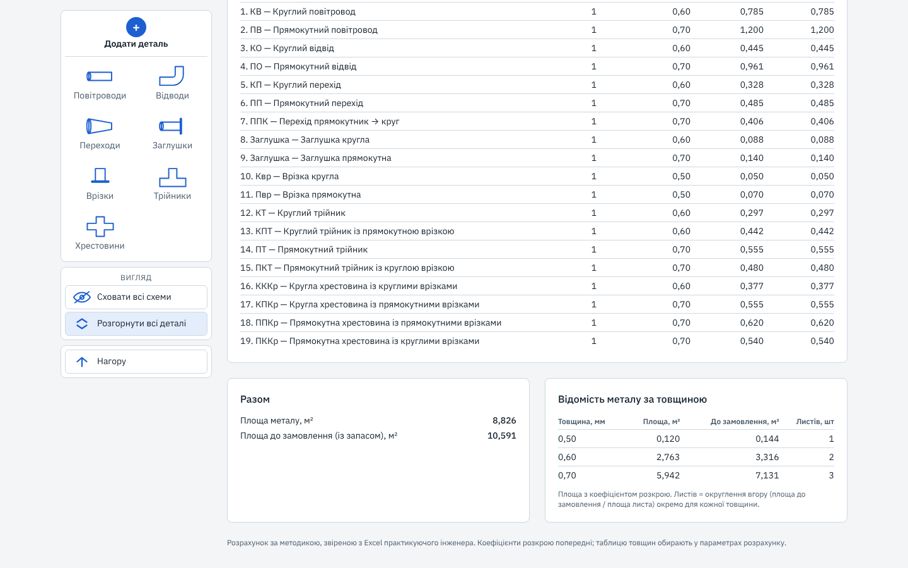
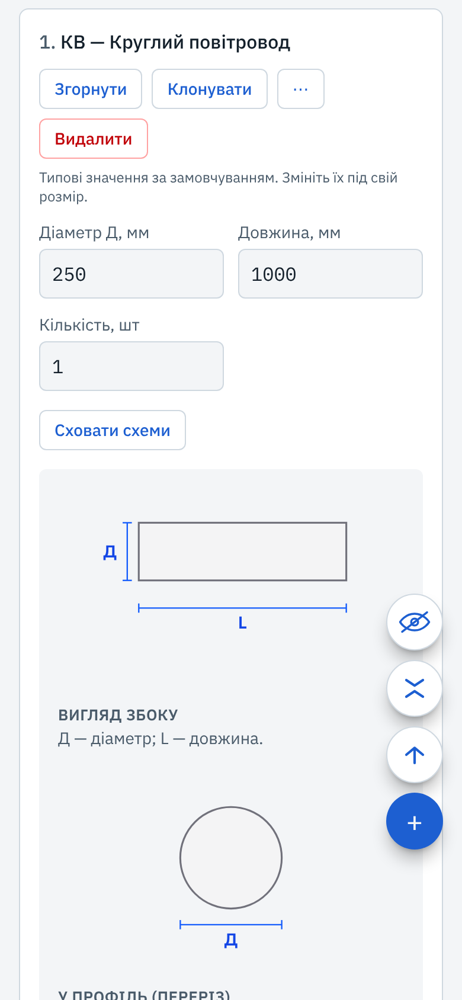

# Калькулятор повітропроводів

[English](README.md) · **Українська**

Веб-калькулятор повітропроводів із листового металу. Ви складаєте перелік фасонних частин вентиляційної системи (прямі повітропроводи, відводи, переходи, трійники, хрестовини, заглушки, врізки) з їхніми розмірами, а калькулятор повертає площу металу кожної позиції, товщину металу за українською нормою та відомість металу за товщинами з кількістю листів до замовлення.

**Онлайн:** https://hvac-duct-calculator-rho.vercel.app

Інтерфейс українською: інструмент створено для проєктувальників вентиляції та цехів, що виготовляють повітропроводи в Україні. Усе рахується в браузері; бекенду немає, нічого не зберігається.


## Що він робить

- **Площа металу кожної позиції.** Розгортка поверхні кожної фасонної частини з її геометрії, із запасом на з'єднання під фланці та коефіцієнтом розкрою для відводів.
- **Товщина металу.** Береться з таблиці ДБН В.2.5-67:2013, додаток Ц (круглі: за діаметром, прямокутні: за більшою стороною). Як варіант доступна власна таблиця інженера.
- **Відомість металу за товщинами.** Площа для кожної товщини, площа до замовлення із запасом (типово 20 %) і кількість листів обраного розміру (1000 × 2000, 1250 × 2500 або 1500 × 3000).
- **Попередження щодо введених даних.** Незвичні, але допустимі значення (співвідношення сторін від 3 і понад 6,3, сторона понад 2000 мм, великий радіус відводу) позначаються і ніколи не змінюються.
- **Схеми.** Кожна картка деталі показує ізометричну схему з літерами розмірів, які використовуються у формі.

| Деталі, згорнуті в плитки, з таблицею результатів | Підсумки та відомість металу за товщинами |
|---|---|
|  |  |

На телефоні бічна панель перетворюється на стовпчик круглих кнопок біля краю екрана зі швидким меню поширених типів і списком усіх типів із пошуком.



## Підтримувані деталі

19 типів, з позначеннями, як в українській специфікації.

| Група | Типи |
|---|---|
| Прямі повітропроводи | круглий (КПв), прямокутний (ППв) |
| Відводи | круглий (КВд), прямокутний (ПВд), будь-який кут |
| Переходи | круглий (КП), прямокутний (ПП), з прямокутника на круг (ППК) |
| Заглушки | кругла, прямокутна |
| Врізки | кругла (Квр), прямокутна (Пвр) |
| Трійники | круглий (КТ), круглий із прямокутною врізкою (КПТ), прямокутний (ПТ), прямокутний із круглою врізкою (ПКТ) |
| Хрестовини | кругла з круглими врізками (ККХ), кругла з прямокутними врізками (КПХ), прямокутна з прямокутними врізками (ППХ), прямокутна з круглими врізками (ПКХ) |

У трійниках і хрестовинах отвори під відгалуження віднімаються від основного повітропроводу; товщина визначається за основним повітропроводом.

## Як перевірено розрахунки

Еталоном є розрахункова таблиця, якою практикуючий інженер-вентиляційник роками користується на реальних об'єктах. Калькулятор побудовано відповідно до неї, а не лише за її мотивами:

- **Фікстури є джерелом істини.** Очікувані значення лежать у [`src/lib/calc/__fixtures__/`](src/lib/calc/__fixtures__/) і комітяться вручну, окремо від коду. Кожен випадок позначено `basis: 'geometry'` (виведено незалежно, з геометрії) або `basis: 'excel'` (відповідає умовності таблиці). Тести ніколи не підганяються під код.
- **Excel є орієнтиром, а не істиною.** Порядкова перевірка виявила помилки у формулах шаблону. Там, де таблиця помиляється, калькулятор рахує правильне значення, а відхилення задокументовано ([ADR 0001](docs/adr/0001-excel-is-a-reference-not-the-truth.md) та [відомі відхилення](docs/decisions.md)).
- **Відкриті питання йдуть до інженера.** Коефіцієнти без підтвердженого джерела зберігаються в конфігурації з позначкою `TODO(confirm)` і вносяться до реєстру, а не вгадуються. Його відповіді записано в [`docs/engineer-answers.md`](docs/engineer-answers.md).
- **Українські норми.** Товщина та обмеження співвідношення сторін узяті з ДБН В.2.5-67:2013.

Кожне інженерне рішення має окремий запис у [`docs/adr/`](docs/adr/) (контекст, рішення, наслідки, джерело) з покажчиком у [`docs/decisions.md`](docs/decisions.md). Документація проєкту англійською.

## Архітектура

```
src/lib/calc/        чисте ядро на TypeScript: геометрія, товщина, коефіцієнт розкрою, кількість листів,
                     властивості повітря та втрати тиску. Без фреймворку і без бібліотеки валідації.
src/lib/validation/  схеми Zod навколо ядра; помилки є стабільними кодами, а не текстом
src/lib/form/        шар форми: сирий текст -> перевірені дані -> результати; типові значення і попередження
src/lib/i18n/        усі рядки, які бачить користувач (український словник)
src/components/      компоненти React; лише props, без розрахунків
```

- Одиниці: міліметри, градуси та м³/год на межі, SI всередині ядра, перетворення в одному модулі.
- Одна довжина розгортки на деталь живить усі значення площі, тож дві копії однієї геометрії не можуть розійтися.
- Ядро також рахує втрати тиску (тертя за Альтшулем, місцеві опори, властивості повітря за заданих умов). Поки що їх приховано в інтерфейсі; вони повернуться як окремий аеродинамічний режим.

## Стек

Next.js (App Router), React, TypeScript (strict), Tailwind CSS, Zod, Vitest. Розгорнуто на Vercel з Vercel Web Analytics. CI на GitHub Actions запускає перевірку типів, лінтер і тести для кожного pull request.

## Локальний запуск

Потрібен Node 24 (див. `.nvmrc`).

```bash
npm ci
npm run dev        # http://localhost:3000
npm test           # модульні тести (Vitest)
npm run typecheck
npm run lint
```

## Плани

- Площа утеплювача
- Адаптери та короби
- Оцінка вартості
- Аеродинаміка як окремий режим
- Експорт специфікації в XLSX
